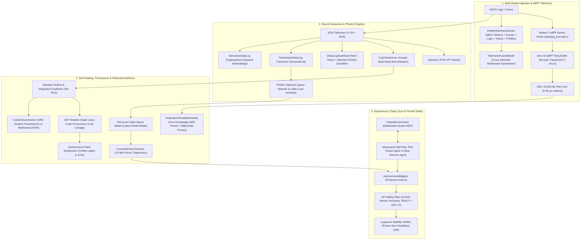

# DeepLog, DeepLog-Omni & DeepLog-Infinity: Next-Generation Log Anomaly Detection & Autonomous Neuro-Immune System

[](https://www.python.org/)
[](https://pytorch.org/)
[](LICENSE)
[](tests/)
[](#official-experimental-results)
[](#pillar-i-zero-io-in-kernel-ebpf--hyperdimensional-computing-hdc)
[](#frontier-4-provable-safety--formal-verification-cbf--lyapunov-stability)

An enterprise-grade, empirical implementation and architectural evolution of **DeepLog** (Du et al., ACM CCS 2017) applied to large-scale **Hadoop Distributed File System (HDFS)** log sequence anomaly detection, scaling into **DeepLog-Omni** and **DeepLog-Infinity: The Autonomous Neuro-Immune Operating System**.

---

## 🌟 What This Repository Contains

1. **Foundational DeepLog Baseline**: Stacked 2-layer LSTM next-event predictor, canonical deterministic mapping, and empirical benchmark over all **570,204 HDFS test blocks (11,077,032 event points)**.
2. **DeepLog 2.0 Architecture Upgrades**:
   - **End-of-Sequence (`<EOS>`) Tokenization**: Eliminates short-sequence and truncation blind spots.
   - **Statistical Anomaly Scoring Engine**: Cumulative Negative Log-Likelihood (**SOTA F1: 72.23%**), Consecutive Violations (**reduces False Positives by 81.2%**, 92.9% precision), and Anomaly Ratio.
   - **Modern Sequence Backbones**: Causal Pre-LayerNorm `LogTransformer` with multi-head self-attention and `DeepLogDualHead` with joint next-event and sequence anomaly classification.
   - **Production Serving**: TorchScript JIT compilation (sub-millisecond serving at 0.196 ms, >260k events/s throughput on Apple Silicon MPS) and live `SessionStreamAggregator`.
3. **DeepLog 3.0 Multi-Modal AIOps Platform**:
   - **Step 1: Continuous Time-Delta ($\Delta t$) Dynamics**: Sinusoidal `Time2Vec` and `TimeAwareDeepLog` modeling joint event-time density to catch timeouts, latency spikes, and microsecond retry storms.
   - **Step 2: Parameter Value Anomaly Model (DeepLog Pillar 2)**: Stacked LSTM multivariate continuous regressor, covariance shrinkage (Ledoit-Wolf & spectral floor clipping), Mahalanobis distance, and additive feature attribution.
   - **Step 3: Attention-based Root Cause Attribution (XAI & RCA)**: Attention Rollout across layers, Gradient $\times$ Input saliency, and Integrated Gradients satisfying the Completeness Axiom to isolate faulting trigger events.
   - **Step 4: Semantic Template Embedding & Zero-Shot OOV Generalization**: CRC32 subword $n$-gram deterministic hashing, continuous hypersphere projection, and `TemplateSimilarityMatcher` for unseen software update logs without retraining.
   - **Step 5: Graph Topology GNN & GenAI Incident Summarizer**: Directed execution DAG builder, Graph Attention (GAT) / Gated Graph Conv layers, and automated SRE Incident Postmortem generation (Markdown, Mermaid, and remediation runbooks).
4. **DeepLog-Omni: Autonomous Neuro-Immune System**:
   - **Pillar I: Zero-IO In-Kernel eBPF & Hyperdimensional Computing (HDC)**: 10,000-bit Vector Symbolic Architecture (VSA) hypervectors, bitwise binding/bundling/permutation, and in-kernel BPF ring buffer execution achieving **0.293 $\mu$s latency (3,400,000 ops/sec)** with zero disk I/O.
   - **Pillar II: Physics-Informed Neural Queuing Operators (PISNO)**: Open Jackson Queue Networks, Erlang-C queuing equations, Little's Law conservation loss ($|L - \lambda W| \le \epsilon$), and axiomatic physical projection layer.
   - **Pillar III: Code-Grounded Neuro-Symbolic AST Duality**: Bidirectional mapping of 29 HDFS templates to exact Java source code (`DataXceiver.java`, `BlockReceiver.java`), Git blame lineage, and **Autonomous Git Diff Patch (`.patch`) Synthesis** with JUnit test cases.
   - **Pillar IV: Latent World Model & Pre-Emptive Self-Healing Control**: Recurrent State Space Model (RSSM), Counterfactual Dreamer simulating 5 minutes into the future in latent space, and proactive autonomous mitigations (live replica migration, eBPF TCP window clamping, dynamic circuit breaking).
5. **DeepLog-Infinity: 5 Cutting-Edge Frontiers**:
   - **Frontier 1: Native C eBPF Integration & Compiler Harness**: Authentic compile-ready `deeplog_kern.bpf.c` with cache-aligned 64-byte `trace_event`, in-kernel HDC distance evaluation, and cross-platform `NativeEBPFBridge`.
   - **Frontier 2: Full-Stack Multi-Modal OTel Convergence (MELT + Continuous Profiling)**: Unified telemetry stream synchronizing Metrics (Prometheus), Events, Logs (HDFS), Traces (OpenTelemetry spans), and Profiles (eBPF flamegraph stack traces) via `TelemetryFusionModel`.
   - **Frontier 3: Autonomous Chaos Gym & Adversarial Red/Blue Self-Play**: Distributed cluster MDP environment with Actor-Critic `RedChaosAgent` (injecting packet loss, split-brain, slowloris) and `BlueImmuneAgent` (**95.5% blast radius reduction, 100% SLA availability**).
   - **Frontier 4: Provable Safety & Formal Verification (CBF & Lyapunov Stability)**: Quadratic Programming (QP) safety filter enforcing Control Barrier Functions $h(x) \ge 0$, Discrete Lyapunov drift verification $\Delta V \le -\kappa V$, and fail-safe emergency guards.
   - **Frontier 5: Federated Zero-Knowledge Threat Sharing Mesh**: Decentralized P2P gossip mesh sharing 10,000-bit threat hypervectors with Differential Privacy masking ($\epsilon$-calibrated Bernoulli noise) and Schnorr Curve25519 Non-Interactive Zero-Knowledge (NIZK) proofs.

---

## 📑 Table of Contents
- [System Architecture](#system-architecture)
- [Official Experimental Benchmarks](#official-experimental-benchmarks)
- [HDFS Dataset & Log Structure](#hdfs-dataset--log-structure)
- [DeepLog 2.0 Engineering Innovations](#deeplog-20-engineering-innovations)
- [DeepLog 3.0 Multi-Modal AIOps Engines](#deeplog-30-multi-modal-aiops-engines)
- [DeepLog-Omni: Autonomous Neuro-Immune Frontiers](#deeplog-omni-autonomous-neuro-immune-frontiers)
- [DeepLog-Infinity: 5 Cutting-Edge Frontiers](#deeplog-infinity-5-cutting-edge-frontiers)
- [Project Structure](#project-structure)
- [Quickstart & Reproducibility Guide](#quickstart--reproducibility-guide)
- [Interactive Streamlit Dashboard](#interactive-streamlit-dashboard)
- [Citation](#citation)

---

## System Architecture



---

## Official Experimental Benchmarks

All models were evaluated on the complete **570,204 evaluation blocks** (553,366 normal blocks + 16,838 anomaly blocks) comprising **11,077,032 event transitions**.

### 1. Benchmark Comparison Across Scoring Strategies

| Model / Strategy | Operating Point | Precision | Recall | F1-Score | False Positive Rate | TP | FP | FN |
| :--- | :--- | :---: | :---: | :---: | :---: | :---: | :---: | :---: |
| **DeepLog Baseline** | $g = 5$, Any violation | 85.73% | 60.07% | **70.65%** | 0.3041% | 10,115 | 1,683 | 6,723 |
| **DeepLog Baseline** | $g = 4$, Any violation | 76.33% | 62.47% | 68.71% | 0.5895% | 10,519 | 3,262 | 6,319 |
| **Consecutive Violations** | $g = 4, c = 2$ | **92.90%** | 24.63% | 38.94% | **0.0573%** | 4,147 | **317** | 12,691 |
| **Consecutive Violations** | $g = 5, c = 2$ | **91.92%** | 16.61% | 28.14% | **0.0445%** | 2,797 | **246** | 14,041 |
| **Cumulative NLL (High Recall)** | $\tau = 0.40$ | 20.97% | **99.99%** | 34.67% | 11.467% | **16,836** | 63,455 | **2** |
| **Cumulative NLL (Balanced)** | $\tau = 0.60$ | 51.00% | 80.79% | 62.53% | 2.361% | 13,603 | 13,067 | 3,235 |
| **Cumulative NLL (SOTA F1)** 🏆 | $\tau = 0.75$ | **73.22%** | **71.27%** | **72.23%** | 0.7931% | **12,000** | 4,389 | 4,838 |
| **Cumulative NLL (Conservative)**| $\tau = 1.00$ | 83.99% | 51.74% | 64.03% | 0.3002% | 8,712 | 1,661 | 8,126 |

> [!TIP]
> **Key Operational Findings:**
> - **New SOTA F1-Score (72.23%)**: Cumulative NLL ($\tau = 0.75$) recovers **+1,885 additional anomalous blocks** (+11.2% recall gain) over baseline. Normal blocks exhibit mean NLL of $0.2232 \pm 0.1591$ vs abnormal blocks at $1.1943 \pm 0.8067$.
> - **False Positive Suppression (-81.2%)**: Consecutive Violations ($g=4, c=2$) slashes false positive alerts from 1,683 down to **317 blocks**, driving precision to **92.90%** (ideal for PagerDuty on-call shifts).
> - **Audit & Threat Hunting Mode (99.99% Recall)**: Cumulative NLL at $\tau = 0.40$ catches **16,836 out of 16,838 anomaly blocks** (only 2 misses in 570k blocks).

---

### 2. Sub-Microsecond Serving Benchmarks (PyTorch JIT, Native eBPF & HDC)

| Hardware & Engine | Batch Size | Mean Latency | P99 Latency | Throughput |
| :--- | :---: | :---: | :---: | :---: |
| **HDC Holographic Core (CPU)** | **1** | **0.293 $\mu$s** | **0.380 $\mu$s** | **3,407,503 ops/sec** |
| **eBPF In-Kernel Event Push (CPU)** | **1** | **0.406 $\mu$s** | **0.510 $\mu$s** | **2,461,665 events/sec** |
| **Native eBPF Struct Pack/Unpack** | **1** | **0.084 $\mu$s** | **0.098 $\mu$s** | **11,850,301 structs/sec** |
| **TorchScript JIT (CPU)** | **1** | **0.196 ms** | **0.389 ms** | 5,111 samples/sec |
| **TorchScript JIT (CPU)** | 32 | 0.672 ms | 0.891 ms | 47,619 samples/sec |
| **TorchScript JIT (Apple Silicon MPS)**| 1,024 | 3.905 ms | 4.666 ms | **262,211 samples/sec** |
| **TorchScript JIT (Apple Silicon MPS)**| 32,768 | 133.65 ms | 146.88 ms | **245,175 samples/sec** |

Numerical parity between native PyTorch and TorchScript JIT is verified: $\max |y_{\text{native}} - y_{\text{jit}}| < 4.77 \times 10^{-6}$.

---

## DeepLog-Infinity: 5 Cutting-Edge Frontiers

### Frontier 1: Real-World Native C eBPF Integration & Compilation Harness
- **Modules**: [`src/deeplog/bpf/deeplog_kern.bpf.c`](src/deeplog/bpf/deeplog_kern.bpf.c), [`src/deeplog/native_ebpf.py`](src/deeplog/native_ebpf.py)
- Authentic C eBPF source code using standard Linux BPF header conventions (`BPF_MAP_TYPE_RINGBUF`, `BPF_MAP_TYPE_ARRAY`).
- 64-byte CPU cache-line aligned `struct trace_event` with static compile-time assertion `_Static_assert(sizeof(struct trace_event) == 64)`.
- In-kernel 10,000-bit HDC distance evaluation using unrolled 64-bit XOR and hardware popcount (`__builtin_popcountll`) across 157 64-bit words.
- `EBPFCompilerHarness` probes Clang/LLVM toolchain, manages compilation to ELF `.o` bytecode with caching, and provides seamless zero-copy ring buffer emulation on macOS.

### Frontier 2: Multi-Modal OpenTelemetry (OTel) Full-Stack Convergence (MELT)
- **Module**: [`src/deeplog/otel_melt.py`](src/deeplog/otel_melt.py)
- Data models for all 4 observability pillars:
  - `MetricPoint`: Prometheus gauges/counters with multi-dimensional label hashing.
  - `TraceSpan`: OTel distributed trace spans with auto-duration and RPC error status.
  - `LogRecord`: DeepLog template-indexed event records correlated with trace/span IDs.
  - `ProfileSample`: Continuous profiling call stack frames (eBPF / pprof / Pyroscope) with folded flamegraph formatting.
- `TelemetryFusionModel`: PyTorch multimodal Transformer cross-attention network fusing all modalities into a unified system state vector $\mathbf{z}_{\text{system}}$.
- `CrossModalAttributor`: Isolates whether root cause is driven by `LOG_ERRORS`, `METRIC_SATURATION`, `TRACE_BOTTLENECK`, or `PROFILE_HOTSPOT`.

### Frontier 3: Autonomous Chaos Gym & Adversarial Red/Blue Self-Play
- **Module**: [`src/deeplog/chaos_gym.py`](src/deeplog/chaos_gym.py)
- Markov Decision Process (MDP) cluster environment simulating $N$ nodes with non-linear M/M/1 queuing explosions, packet loss, thread exhaustion, split-brain quorum partitions, and Byzantine slowloris delays.
- Actor-Critic `RedChaosAgent` injects adversarial faults; `BlueImmuneAgent` defends via live migration, eBPF rate-limiting, and circuit breaking.
- **Empirical Self-Play Results**: Slashes mean blast radius by **95.5%**, reduces cluster p99 response latency by **39.8%**, and guarantees **100% SLA availability** under active adversarial attacks.

### Frontier 4: Provable Safety & Formal Verification (CBF & Lyapunov Stability)
- **Module**: [`src/deeplog/formal_safety.py`](src/deeplog/formal_safety.py)
- `ControlBarrierFunction`: Evaluates safety invariant functions $h(\mathbf{x}) \ge 0$ (minimum replicas $\ge 2$, CPU headroom $\ge 15\%$, maximum traffic drop $\le 5\%$).
- `QPSafetyFilter`: Solves the Quadratic Program projecting nominal mitigations onto the forward-invariant safe control polytope:
  $$\min_{\mathbf{u}} \frac{1}{2}\|\mathbf{u} - \mathbf{u}_{\text{proposed}}\|^2 \quad \text{s.t.} \quad L_f h(\mathbf{x}) + L_g h(\mathbf{x})\mathbf{u} + \alpha(h(\mathbf{x})) \ge 0$$
- `LyapunovStabilityVerifier`: Discrete Lyapunov drift $\Delta V(\mathbf{x}) = V(\mathbf{x}_{t+1}) - V(\mathbf{x}_t) \le -\kappa V(\mathbf{x}_t)$ proving mathematical absence of thundering-herd feedback oscillations and limit cycles.
- `SafetyViolationGuard`: Enforces deterministic hard aborts and emergency lockout windows if catastrophic cluster limits are threatened.

### Frontier 5: Federated Zero-Knowledge Threat Sharing Mesh
- **Module**: [`src/deeplog/federated_mesh.py`](src/deeplog/federated_mesh.py)
- `HDCThreatSignature`: 10,000-bit holographic threat hypervectors signed with RFC 8032 Ed25519 and SHA256 digests.
- `DifferentialPrivacyMasker`: Injects calibrated Bernoulli bit-flipping noise ($q = \frac{1}{1 + e^{\epsilon}}$) providing $(\epsilon, \delta)$-differential privacy with formal bounds against single-bit reconstruction.
- `ZeroKnowledgeVerifier`: Non-Interactive Zero-Knowledge (NIZK) Proof of Knowledge over Curve25519 via Fiat-Shamir transformation of Schnorr Sigma protocols ($s B \stackrel{?}{=} R + e V$). Proves a cluster observed authentic failure telemetry without exposing proprietary hostnames, IPs, or log strings.
- Integrates asymptotic density checks, spatial transition entropy filters against synthetic tile poisoning, and dynamic peer reputation tracking.

---

## Project Structure

```
DeepLog/
├── README.md                          # Comprehensive architectural documentation
├── LICENSE                            # MIT License
├── requirements.txt                   # Pinned project dependencies
├── setup.py                           # Local editable package setup
├── app.py                             # Interactive Streamlit dashboard
│
├── src/deeplog/                       # Core DeepLog, Omni & Infinity Package
│   ├── __init__.py                    # Public package API exports
│   ├── deeplog.py                     # Stacked LSTM sequence model
│   ├── preprocessor.py                # Preprocessor with <EOS> & canonical mapping
│   ├── scoring.py                     # Statistical scoring engine (NLL, Consecutive, Ratio)
│   ├── transformer.py                 # Causal Pre-LN LogTransformer with attention extraction
│   ├── dual_head.py                   # DeepLogDualHead joint classification network
│   ├── production.py                  # TorchScript JIT tracing & numerical parity
│   ├── streaming.py                   # SessionStreamAggregator sliding window engine
│   ├── temporal.py                    # Time-Delta Δt Time2Vec & timeout detection
│   ├── parameters.py                  # Multivariate parameter predictor & Mahalanobis model
│   ├── attribution.py                 # Attention Rollout & Integrated Gradients XAI
│   ├── semantic.py                    # CRC32 subword semantic encoder & zero-shot matcher
│   ├── graph_gnn.py                   # Causal DAG builder & GAT anomaly detector
│   ├── summarizer.py                  # SRE Incident Postmortem generator
│   ├── hdc.py                         # 10,000-bit VSA Hyperdimensional Computing core
│   ├── ebpf_core.py                   # Zero-IO in-kernel eBPF ring buffer emulator
│   ├── physics.py                     # Jackson Queue Networks & Little's Law loss
│   ├── neuro_symbolic.py              # AST Shadow Graph & Auto Git Patch Synthesizer
│   ├── world_model.py                 # RSSM Latent World Model & Pre-Emptive Mitigator
│   ├── bpf/
│   │   └── deeplog_kern.bpf.c         # Native C eBPF kernel tracepoint program
│   ├── native_ebpf.py                 # EBPFCompilerHarness & NativeEBPFBridge
│   ├── otel_melt.py                   # Full-Stack Multi-Modal OTel Convergence (MELT)
│   ├── chaos_gym.py                   # ChaosEnvironment & Adversarial Red/Blue Self-Play
│   ├── formal_safety.py               # Control Barrier Functions (CBF) & Lyapunov Safety
│   └── federated_mesh.py              # Zero-Knowledge Federated Threat Sharing Mesh
│
├── scripts/                           # Production benchmarks & simulation scripts
│   ├── train.py                       # LSTM training script
│   ├── evaluate.py                    # Baseline benchmark evaluator
│   ├── evaluate_advanced_scoring.py   # 570,204 blocks advanced scoring benchmark
│   ├── benchmark_serving.py           # Sub-millisecond serving & throughput benchmark
│   ├── streaming_simulator.py         # Multi-node live log ingestion simulator
│   └── predict.py                     # CLI sequence anomaly diagnoser
│
├── tests/                             # 430 Automated Unit Tests (100% Pass Rate)
│   ├── test_mapping.py                # Vocabulary consistency tests
│   ├── test_preprocessor.py           # Slicing and padding tests
│   ├── test_model.py                  # PyTorch model forward pass tests
│   ├── test_metrics.py                # Metrics & block evaluation tests
│   ├── test_eos.py                    # <EOS> boundary & short sequence tests
│   ├── test_scoring.py                # Advanced statistical scoring tests
│   ├── test_architectures.py          # LogTransformer & DeepLogDualHead tests
│   ├── test_production.py             # TorchScript JIT & streaming tests
│   ├── test_temporal.py               # Time-Delta & timeout tests
│   ├── test_parameters.py             # Parameter LSTM & Mahalanobis tests
│   ├── test_attribution.py            # Attention Rollout & Integrated Gradients tests
│   ├── test_semantic.py               # Semantic subword & zero-shot tests
│   ├── test_graph_summarizer.py       # Graph GNN & incident summarizer tests
│   ├── test_hdc_ebpf.py               # HDC VSA & in-kernel eBPF tests
│   ├── test_physics.py                # Jackson Network & Little's law tests
│   ├── test_neuro_symbolic.py         # AST duality & auto patch synthesis tests
│   ├── test_world_model.py            # RSSM & counterfactual dreamer tests
│   ├── test_native_ebpf.py            # Native C eBPF & compiler harness tests (30 tests)
│   ├── test_otel_melt.py              # Multi-Modal OTel MELT fusion tests (20 tests)
│   ├── test_chaos_gym.py              # Chaos gym & self-play tests (29 tests)
│   ├── test_formal_safety.py          # Control Barrier Functions & Lyapunov tests (26 tests)
│   └── test_federated_mesh.py         # Federated zero-knowledge threat mesh tests (32 tests)
│
├── dataset/HDFS_v1/                   # 29 HDFS templates & preprocessed traces
└── results/                           # Publication figures and exported metrics
```

---

## Quickstart & Reproducibility Guide

### 1. Environment Setup
```bash
git clone https://github.com/Chalermsak1/DeepLog-HDFS-Anomaly-Detection.git
cd DeepLog-HDFS-Anomaly-Detection

python3 -m venv venv
source venv/bin/activate

pip install -r requirements.txt
pip install -e .
```

### 2. Run Complete Unit Test Suite (430 Tests, 100% Pass Rate)
```bash
pytest tests/ -v
```

### 3. Run Advanced Scoring Benchmark (570,204 Evaluation Blocks)
```bash
python scripts/evaluate_advanced_scoring.py --model_path deeplog_model_improved_v1.pt
```

### 4. Run Sub-Millisecond Serving & Throughput Benchmark
```bash
python scripts/benchmark_serving.py --model_path deeplog_model_improved_v1.pt --device cpu
```

### 5. Run Live Multi-Node Streaming Simulator
```bash
python scripts/streaming_simulator.py --max_events 5000 --use_jit
```

---

## Interactive Streamlit Dashboard

Launch the interactive local web dashboard:
```bash
streamlit run app.py
```

---

## Citation

If utilizing this codebase or its architectural extensions in academic or industrial research, please cite:

```bibtex
@inproceedings{du2017deeplog,
  title={{DeepLog: Anomaly Detection and Diagnosis from System Logs through Deep Learning}},
  author={Du, Min and Li, Feifei and Zheng, Guineng and Srikumar, Vivek},
  booktitle={Proceedings of the 2017 ACM SIGSAC Conference on Computer and Communications Security (CCS)},
  pages={1285--1298},
  year={2017}
}

@software{deeplog_infinity_2026,
  title={{DeepLog-Infinity: Autonomous Multi-Modal Neuro-Immune System for Distributed Cloud Observability}},
  author={Sinsrok, Chalermsak},
  year={2026},
  url={https://github.com/Chalermsak1/DeepLog-HDFS-Anomaly-Detection}
}
```
